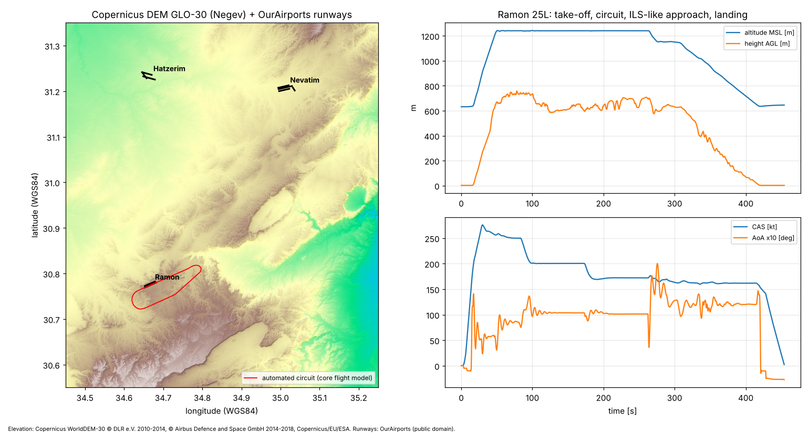

# כנף (Kanaf Sim) — סימולטור טיסה בתלת־ממד

סימולטור טיסה ל־Windows על בסיס **Unreal Engine 5** (C++), עם ליבת סימולציה עצמאית ב־C++ שנבדקת אוטומטית מחוץ למנוע.
המיקוד: מטוסי הקרב, התקיפה והמודיעין המודרניים של חיל האוויר, מפות אמיתיות של אזור הנגב, ובסיסים בשמותיהם האמיתיים.

> **הבהרה:** פרויקט עצמאי. אינו קשור לצה"ל, לחיל האוויר או ליצרנים, ואינו מבוסס על מידע שאינו פומבי. המקומות אמיתיים, התרחישים, היריבים ואותות הקריאה בדיוניים. ביצועים שאינם פומביים מוגדרים כ"ערכי משחק".


*טיסה אוטומטית מלאה ברמון 25L, מחושבת בליבת הסימולציה: המראה, הקפה, גישה ונחיתה. מוצגת על מודל הגובה (Copernicus DEM) ועל המסלולים מ־OurAirports.*

---

## מצב נוכחי — מה עובד ומה נבדק בפועל

| רכיב | מצב | אימות |
|---|---|---|
| ליבת סימולציה (6DOF, חוקי בקרה, כני נסע, דלק, חימוש כמסה וגרר) | ממומש | **נבנה ונבדק**: 258 בדיקות אוטומטיות עוברות (g++ 13, Linux) |
| המראה → הקפה → נחיתה → עצירה | ממומש | **נבדק** אוטומטית ברמון (07R, 25L), בנבטים ובחצרים, וגם במצב השטח השטוח החלופי |
| קטלוג מטוסים, חימושים, תאימות ובסיסים (JSON) | ממומש | **נבדק**: אימות הפניות, מקורות וסטטוס שירות |
| חסימת תצורות חימוש לא מתועדות | ממומש | **נבדק** |
| שטח אמיתי: נגב, Copernicus DEM ברזולוציית 30 מ' | ממומש | **נבדק** מול גובהי המסלולים: ברמון הפער עד 4 מ' |
| מערכת קשר בעברית: תור, מצבים, כתוביות ואפקט רדיו | ממומש | **נבדק** לוגית וספקטרלית. ההבנה השמיעתית **לא נבדקה** (ר' מגבלות) |
| פרויקט Unreal (משחק, ממשק RTL, HUD, האנגר, אודיו) | נכתב | **לא קומפל ולא הורץ**: בסביבת הפיתוח אין Unreal Engine ואין Windows |
| Cesium ו־Google Photorealistic 3D Tiles | תוסף אופציונלי, כבוי כברירת מחדל | **לא נבדק**: אין מפתח API, והגישה ל־Cesium ion חסומה בסביבה |

הפירוט המלא נמצא ב־[docs/TEST_REPORT.md](docs/TEST_REPORT.md).

## סביבת הפיתוח שנבדקה
- Ubuntu 24.04 בענן, 4 ליבות Xeon 2.3GHz, זיכרון 15GB, **ללא GPU**.
- **חסרים לבניית המשחק:** Unreal Engine 5.7, Visual Studio 2022 (MSVC v143 ו־Windows SDK) ומחשב Windows עם GPU תומך DX12. לכן נבנתה ונבדקה רק ליבת ה־C++ ב־CMake. קוד ה־UE נכתב מול ה־API של 5.6–5.7 אך טרם קומפל.

## בחירת גרסאות
- **Unreal Engine 5.7**: לפי הודעות Cesium מאוגוסט 2026, תוסף Cesium for Unreal דורש 5.6 ומעלה ונוספה תמיכה ב־5.8. הבחירה ב־5.7 בתוך הטווח הנתמך היא הסקה שלי, ולא נמצאה טבלת תאימות רשמית. כדאי לבדוק בדף התוסף לפני ההתקנה.
- ‏C++17/20, ‏Enhanced Input, ‏ProceduralMeshComponent ו־RawInput (ל־HOTAS ב־Windows).
- **JSBSim לא שולב.** הרישיון (LGPL) מאפשר זאת, אבל אין מודל F-16I ציבורי מאומת. מודל ה־F-16 הציבורי של JSBSim מתאר דגם כללי, ושילובו היה מוסיף תלות בלי לשפר את הדיוק לגרסה הישראלית. במקומו נבנה מודל משחקי מתועד ([docs/FLIGHT_MODEL.md](docs/FLIGHT_MODEL.md)) שאפשר להחליף בהמשך.

## התקנה והפעלה (Windows)
1. התקן Unreal Engine 5.7 דרך Epic Games Launcher, ו־Visual Studio 2022 עם רכיבי "Game development with C++", MSVC v143 ו־Windows 10/11 SDK.
2. לחץ קליק ימני על `KanafSim/KanafSim.uproject` ובחר **Generate Visual Studio project files**.
3. פתח את `KanafSim.sln` ובנה את התצורה `Development Editor | Win64`. אפשר גם לפתוח ישירות את קובץ ה־uproject ולאשר בנייה.
4. ב־Editor לחץ **Play**. המשחק בונה את העולם בזמן ריצה על המפה הריקה של המנוע (`/Engine/Maps/Entry`), כך שאין צורך בקובצי מפה.
5. לאריזה: File → Package Project → Windows. התיקייה `Content/KanafData` נארזת כקבצים רגילים.

**בדיקות הליבה (כל מערכת הפעלה):**
```bash
cd core-tests
cmake -S . -B build -G Ninja && cmake --build build
./build/kanaf_tests            # 258 בדיקות
./build/kanaf_sim_cli ramon 25L flight.csv   # טיסה אוטומטית מלאה, טלמטריה ל-CSV
./build/kanaf_radio_render ../docs/audio-samples 0.5 1.0   # עיבוד שידורי קשר לקובצי WAV
```

## שליטה (ברירת מחדל, ניתן לשינוי במסך "שינוי מקשים")
| פעולה | מקלדת ועכבר | שלט | HOTAS (RawInput) |
|---|---|---|---|
| גובה (Pitch) | S משיכה, W דחיפה | סטיק שמאלי Y | Axis2 |
| גלגול | A / D | סטיק שמאלי X | Axis1 |
| הגה כיוון | Q / E | כתפיות | Axis4 |
| מצערת | Shift / Ctrl | הדקים | Axis3 (מוחלט) |
| בלמים / בלם חניה | רווח / P | B | — |
| כני נסע / בלם אוויר / חופה | G / B / K | Y / X | — |
| מצלמה / מבט חופשי | C / החזקת לחצן ימני + עכבר | לחיצה על סטיק ימני / סטיק ימני | — |
| קשר: תפריט / תשובה / אישור / חזרה / ערוץ | Tab / 1–3 / T / Y / U | D-Pad | — |
| איפוס / תפריט / עזרה / מצב שליטה | R / Esc / F1 / F2 | — | — |

**HOTAS:** הפעל את תוסף RawInput (מופעל כברירת מחדל ב־uproject) והוסף את מזהי ה־VID/PID של ההתקן ב־`Config/DefaultInput.ini`. דוגמה מופיעה בקובץ. הצירים יופיעו כ־`GenericUSBController_AxisN`.

## מבנה הפרויקט
```
flight-sim/
├─ KanafSim/                     פרויקט Unreal
│  ├─ KanafSim.uproject
│  ├─ Config/                    הגדרות מנוע, משחק וקלט
│  ├─ Source/KanafCore/          ליבת סימולציה טהורה (ללא Unreal): פיזיקה, גאו, קטלוג, משימות, קשר
│  ├─ Source/KanafSim/           מודול המשחק: Pawn, ‏HUD, ממשק RTL, עולם, אודיו, האנגר
│  ├─ Plugins/KanafCesium/       ספק תצוגה אופציונלי ל-Google 3D Tiles (כבוי)
│  └─ Content/KanafData/         כל הנתונים, בנפרד מהקוד
│     ├─ Catalog/                aircraft, weapons, compatibility, bases, missions, sources, flight_profiles
│     ├─ Terrain/                negev_height.r16/.json (Copernicus DEM)
│     ├─ Radio/phrases.he.json   מאגר המשפטים, ההגייה והתשובות
│     ├─ Audio/Radio/            קובצי קול זמניים (espeak-ng)
│     ├─ UI/strings.he.json      מחרוזות הממשק
│     └─ Fonts/                  Noto Sans + Noto Sans Hebrew (OFL)
├─ core-tests/                   CMake: בדיקות, טיסה אוטומטית, רינדור קשר
├─ tools/                        בניית DEM, חילוץ בסיסים, יצירת קולות, בדיקת כיסוי Google, גרף אימות
└─ docs/                         ארכיטקטורה, מחקר, מודל טיסה, מפות, קשר, נכסים, בדיקות, מפת דרכים
```

## תלויות ורישיונות
| רכיב | רישיון / תנאים | הערה |
|---|---|---|
| Unreal Engine 5.7 | EULA של Epic | נדרש לבנייה |
| Copernicus DEM GLO-30 | שימוש חופשי עם ייחוס חובה | הייחוס מוצג במשחק ובקובץ ה־json |
| OurAirports | Public Domain | מיקומי ספי מסלול וגבהים, לא ברמת מדידה |
| Noto Sans / Noto Sans Hebrew | SIL OFL 1.1 | `Content/KanafData/Fonts` |
| espeak-ng | GPL-3.0 (הכלי בלבד) | שימש ליצירת קובצי קול זמניים. הכלי עצמו אינו חלק מהמשחק |
| Cesium for Unreal | Apache-2.0 | אופציונלי |
| Google Map Tiles API | תנאי Google Maps Platform, בתשלום | אופציונלי. ייחוס חובה, מגבלות אחסון. ר' [docs/MAPS.md](docs/MAPS.md) |

**מפתחות API לא נשמרים במאגר.** מפתח Google נקרא ממשתנה הסביבה `KANAF_GOOGLE_MAPS_KEY` או מהקובץ `Saved/Config/KanafSecrets.ini`, שאינו נכלל במאגר.

## מקורות מידע
כל המקורות, עם תאריך הבדיקה ושיטת הגישה, מרוכזים ב־`Content/KanafData/Catalog/sources.json` ובסיכום ב־[docs/RESEARCH.md](docs/RESEARCH.md).
חשוב לדעת: חלק מהמקורות נקראו רק כתקצירי חיפוש, כי האתרים חסומים ברשת של סביבת הפיתוח. הדבר מסומן בכל רשומה.

## מגבלות ידועות
- קוד ה־Unreal לא קומפל ולא הורץ. סביר שיידרשו תיקוני קומפילציה קטנים בפתיחה הראשונה.
- המודל החיצוני, הקוקפיט והצליל זמניים ומסומנים כך במשחק. הקוקפיט הוא ייצוג משחקי, **לא** שחזור של F-16I. ר' [docs/ASSETS.md](docs/ASSETS.md).
- צבעי הקרקע הם השלמה אמנותית לפי גובה ושיפוע, בלי צילומי אוויר. הגבהים עצמם אמיתיים.
- הבסיסים מוצגים באופן סכמטי (מסלולים בלבד). מבנים, מסלולי הסעה ודתקים אינם משוחזרים.
- הקולות העבריים נוצרו ב־espeak-ng מתעתיק פונטי. איכותם רובוטית, וההבנה השמיעתית לא נבדקה. יש להחליפם בהקלטות או במנוע TTS בעל רישיון מסחרי.
- נתוני התאימות של החימוש נשענים ברובם על תקצירי חיפוש. לכן AIM-120 ל־F-16I מסומן "דווח בלבד" וחסום לבחירה.
- טווח שלב 1 הוא אזור הנגב בלבד (30.40°–31.50° צפון, 34.30°–35.40° מזרח). מחוץ לו מוצג שטח שטוח חלופי, עם הודעה מתאימה.
