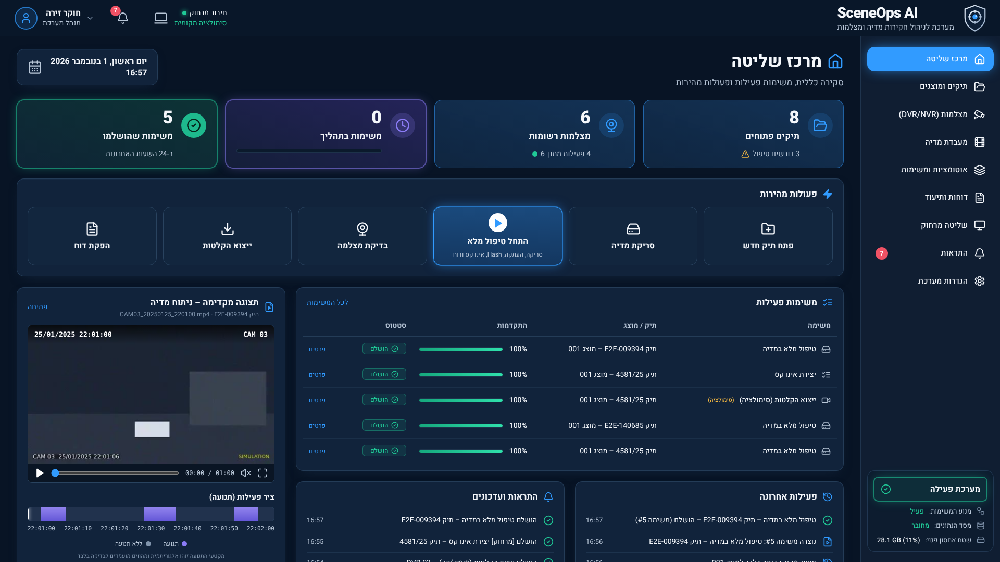

# SceneOps AI – מערכת לניהול חקירות מדיה ומצלמות

אפליקציה מקומית (Windows-first) לניהול תהליכי עבודה פורנזיים דיגיטליים עבור חוקרים מורשים:
תיקים ומוצגים, מכשירי CCTV/DVR/NVR, מדיית וידאו, אימות שלמות (SHA-256), עותקי עבודה מאומתים,
ציר זמן, ניתוח תנועה, דוחות PDF/DOCX בעברית, משימות אוטומטיות ושליטה מרחוק מבוקרת.

> **חשוב:** זוהי גרסת MVP להדגמה מקומית. היא **לא** עברה הסמכה או תיקוף פורנזי, ואין בה כדי להבטיח
> קבילות ראייתית או עמידה בתקן כלשהו. כל הנתונים המצורפים (תיקים, שמות, מכשירים ומדיה) **בדויים**.
> ייצוא ממכשירים ושליטה מרחוק הם **סימולציה** עד לשילוב מאושר ארגונית.



---

## התקנה מהירה (Windows 10/11)

### דרישות מקדימות

| רכיב | גרסה | התקנה מומלצת |
|---|---|---|
| Python | 3.12 | `winget install Python.Python.3.12` |
| Node.js | 20 ומעלה (LTS) | `winget install OpenJS.NodeJS.LTS` |
| FFmpeg + FFprobe | כל גרסה עדכנית | `winget install Gyan.FFmpeg` |

לאחר ההתקנה יש לפתוח חלון PowerShell **חדש** כדי שה-PATH יתעדכן.

### התקנה – פקודה אחת

```powershell
cd <תיקיית הפרויקט>\sceneops
powershell -ExecutionPolicy Bypass -File scripts\setup.ps1
```

הסקריפט:
1. בודק תלויות (Python 3.12, Node.js, FFmpeg).
2. יוצר `.env` מתוך `.env.example`.
3. יוצר סביבת Python ב-`backend\.venv` ומתקין חבילות.
4. מריץ מיגרציות Alembic ויוצר מסד SQLite ב-`data\sceneops.db`.
5. יוצר מדיית CCTV **סינתטית** (FFmpeg) ונתוני הדגמה בדויים, ומוסיף לתור משימת "טיפול מלא" לדוגמה.
6. מתקין את חבילות ממשק המשתמש (`npm ci`).

### הפעלה

```powershell
powershell -ExecutionPolicy Bypass -File scripts\start-all.ps1
```

נפתחים שלושה חלונות: שרת API (`127.0.0.1:8000`), מנוע משימות, וממשק משתמש (`127.0.0.1:5173`).
פתחו בדפדפן: **http://127.0.0.1:5173**

ניתן גם להפעיל כל רכיב בנפרד: `start-backend.ps1`, `start-worker.ps1`, `start-frontend.ps1`.

**מצב פורט יחיד:** `scripts\build.ps1` בונה את הממשק, ואז `start-backend.ps1` + `start-worker.ps1`
מגישים הכל בכתובת http://127.0.0.1:8000.

### משתמשי הדגמה (בדויים)

| משתמש | סיסמה | תפקיד |
|---|---|---|
| `admin` | `Admin!2025` | מנהל מערכת ("חוקר זירה") |
| `noa` | `Invest!2025` | חוקרת |
| `yoav` | `Invest!2025` | חוקר |
| `viewer` | `Viewer!2025` | צופה (קריאה בלבד) |

משתמשי ההדגמה פעילים רק כאשר `SCENEOPS_DEMO_MODE=true`.

---

## תרחיש הדגמה מומלץ

1. התחברו כ-`noa`. במרכז השליטה תראו את משימת "טיפול מלא" לדוגמה (אם מנוע המשימות פועל היא תסתיים תוך שניות),
   תצוגה מקדימה של הווידאו וציר תנועה.
2. **פתח תיק חדש** → הוסיפו מוצג.
3. בכרטיס המוצג: **הוספת מקור** → בחרו תיקייה מתוך `sample_data\evidence` (נתיב מורשה), הזינו אסמכתת הרשאה
   וסמנו את אישור ההרשאה.
4. **טיפול מלא** – צפו בהתקדמות בזמן אמת (SSE): סריקה לקריאה בלבד → SHA-256 → עותק עבודה מאומת →
   FFprobe → תמונות ממוזערות וקובצי תצוגה → אינדקס → ציר זמן (כולל פער הקלטה ואי-התאמת זמן מכוונים במדיה
   הסינתטית) → ניתוח תנועה (OpenCV) → טיוטת דוח.
5. **דוחות ותיעוד** → פתחו את הטיוטה, הורידו PDF/DOCX, הגישו לבדיקה. אישור מתבצע על ידי בודק אחר או מנהל
   (לא ניתן לאשר גרסה שהפקתם בעצמכם).
6. **מצלמות** → בדיקת חיבור (סימולציה) ו**ייצוא הקלטות** (סימולציה) – דורש אסמכתת הרשאה, ערוצים, טווח זמן ויעד.
7. **שליטה מרחוק** (כ-`admin`) → הפעלת "סימולציה מקומית" → הגשת משימה מותרת (כ-`noa`) → אישור במסך
   האוטומציות (כ-`admin`) → "הפעלת מחזור סוכן הדגמה" או `scripts\start-agent.ps1`.

---

## ארכיטקטורה

```
sceneops/
├─ backend/                FastAPI · SQLAlchemy · Alembic · Pydantic (Python 3.12)
│  ├─ app/main.py          אפליקציית API, טיפול שגיאות אימות בעברית, הגשת הממשק הבנוי
│  ├─ app/models.py        מודלי נתונים (19+ טבלאות, enum, אינדקסים, מפתחות זרים)
│  ├─ app/security.py      PBKDF2, סשנים עם פקיעה, הרשאות לפי תפקיד, הגנת נתיבים
│  ├─ app/audit.py         יומן ביקורת בשרשרת גיבוב + התראות
│  ├─ app/routers/         cases · media · jobs (+SSE) · cameras · reports · remote · system
│  ├─ app/worker/          תור עמיד, מכונת מצבים, הגדרות תהליכים ומטפלי שלבים
│  ├─ app/services/        FFmpeg/FFprobe/OpenCV, דוחות PDF/DOCX, מתאמי מצלמות, מדיה סינתטית
│  ├─ app/agent/           לקוח סוכן ופרוטוקול חתימה (HMAC + nonce)
│  ├─ alembic/             מיגרציות
│  └─ tests/               pytest
├─ frontend/               React · TypeScript · Vite · Tailwind · רכיבי shadcn/ui · TanStack Query · React Router
│  ├─ src/pages/           כל מסכי המערכת
│  ├─ src/components/      Layout, רכיבי UI, דיאלוגים, נגן וידאו, ציר זמן
│  └─ e2e/                 Playwright
├─ scripts/                סקריפטי PowerShell (התקנה, הפעלה, בדיקות, איפוס)
├─ sample_data/evidence/   מדיה סינתטית שנוצרת בהתקנה (לא נשמרת ב-git)
└─ data/                   מסד, אחסון עותקי עבודה ודוחות (לא נשמר ב-git)
```

### מודל נתונים
Users, Roles, UserSessions, Cases, Exhibits, EvidenceSources, CustodyEvents, Cameras, Channels, MediaFiles,
HashRecords, WorkingCopies, Findings, Jobs, JobSteps, JobLogs, Reports, ReportRevisions, Approvals,
AuditEvents, Notifications, Agents, AgentNonces, AuthorizedRoots, SystemSettings.

SQLite משמש ל-MVP (WAL). המעבר ל-PostgreSQL: התקנת `psycopg` והגדרת `SCENEOPS_DATABASE_URL` –
המודלים משתמשים בטיפוסים ניידים (enum כ-VARCHAR+CHECK, JSON) והמיגרציות במצב batch.

### תור משימות ומכונת מצבים
- משימות ושלביהן נשמרים במסד – אין מצב בזיכרון בלבד.
- מצבים: `awaiting_approval → queued → running → succeeded | failed | cancelled`, וכן
  `running → cancel_requested → cancelled`, `failed/cancelled → queued` (ניסיון חוזר).
- תפיסה אטומית (UPDATE מותנה) וחכירה (lease) עם חידוש; עובד שנפל – המשימה חוזרת לתור וממשיכה
  **מהשלב שלא הושלם** (שלבים אידמפוטנטיים: Hash שכבר חושב או עותק מאומת אינם מחושבים שוב).
- ביטול בגבולות בטוחים (בין מקטעי קריאה, בין קבצים ובין שלבים).
- ניסיונות חוזרים עם השהיה מעריכית לשגיאות זמניות; שגיאות קבועות (נתיב לא מורשה, שינוי מקור) אינן חוזרות.
- נעילת מוצג: משימה "בלעדית" לא תרוץ במקביל למשימה בלעדית אחרת על אותו מוצג.
- עדכוני התקדמות לממשק ב-SSE (`/api/events/stream`).

### תהליכי עבודה
סריקת כונן · טיפול מלא במדיה · חישוב Hash · יצירת עותק עבודה מאומת · יצירת אינדקס · יצירת ציר זמן ·
ניתוח תנועה · הפקת דוח · בדיקת שלמות תיק · ייצוא הקלטות (סימולציה).

---

## עקרונות פורנזיים ושמירה על הראיה

- **המקור אינו משתנה לעולם:** קבצי מקור נפתחים לקריאה בלבד (`rb`). גודל וזמן שינוי נבדקים לפני ואחרי
  חישוב Hash; שינוי במהלך הקריאה מסמן את הקובץ ועוצר את התהליך.
- **עותק עבודה מאומת:** העתקה לקובץ זמני תוך גיבוב, שינוי שם אטומי, קריאה חוזרת וחישוב Hash שני,
  השוואה ל-Hash המקור, וסימון העותק לקריאה בלבד.
- **נגזרות רק מעותקי עבודה:** תמונות ממוזערות, קובצי תצוגה (H.264) ופריימים נוצרים מהעותק בלבד.
  הנגן בממשק אינו ניגש לקובץ המקור.
- **ממצאים הם מועמדים לבדיקה:** תנועה, פערי הקלטה ואי-התאמות זמן מסומנים "מועמד לבדיקה" ומחייבים
  החלטה ידנית מתועדת (אושר/נדחה).
- **זמנים:** זמני מערכת נשמרים ב-UTC ומוצגים בשעון ישראל; זמני הקלטה מוצגים לפי שעון המכשיר כפי שנרשמו,
  ללא תיקון היסט (היסט השעון נרשם בנפרד לכל מכשיר).
- **שרשרת משמורת ויומן ביקורת:** כל פעולה מתועדת; יומן הביקורת מקושר בשרשרת SHA-256 וניתן לאימות.
- **דוחות:** נבנים מנתונים שמורים בלבד, כוללים גרסאות כלים, ערכי Hash, שגיאות, ממצאים לבדיקה ושרשרת
  משמורת. טיוטות מסומנות בסימן מים; אישור יוצר גרסה מאושרת עם פרטי המאשר.

---

## אבטחה – הדגמה מול ייצור

| נושא | ממומש ב-MVP | נדרש לפריסה ארגונית |
|---|---|---|
| זהות | משתמשים מקומיים, PBKDF2-SHA256, סשנים עם פקיעה | SSO/AD, MFA, ביטול משתמשי הדגמה |
| הרשאות | מנהל / חוקר / צופה, בעלות על תיקים, הפרדת סמכויות באישור דוחות | מדיניות ארגונית מפורטת |
| נתיבים | רשימת נתיבי מקור מורשים, חסימת Path Traversal וקישורים סימבוליים, הפרדת אחסון | הקשחת מערכת קבצים, הצפנה במנוחה |
| רשת | האזנה ל-127.0.0.1 בלבד; ללא קריאות חיצוניות או ענן | TLS, mTLS לסוכנים, חומת אש |
| סודות | לא נרשמים ביומנים; סיסמאות מכשירים אינן נשמרות | כספת סודות ארגונית |
| קלט | אימות Pydantic, מגבלת גודל בקשה, הודעות שגיאה בעברית | בדיקות חדירה |

### שליטה מרחוק
- **כבויה כברירת מחדל.** גישה ברשת אינה זמינה ב-MVP.
- מצב "סימולציה מקומית" מאפשר לסוכן מקומי (127.0.0.1 בלבד) למשוך משימות מרשימה סגורה בלבד:
  סריקה, Hash, עותק עבודה מאומת, אינדקס/תמונות ממוזערות, הפקת דוח.
- כל בקשת סוכן נחתמת ב-HMAC-SHA256 על שיטה, נתיב, זמן, nonce וגיבוב הגוף; חלון זמן של 60 שניות;
  nonce חד-פעמי (הגנת replay); זהות סוכן; נתיבים מותרים לכל סוכן; אישור מנהל לכל משימה.
- **לא ממומש בכוונה:** הרצת פקודות מעטפת, שולחן עבודה מרוחק, חילוץ פרטי גישה, גישה חופשית לקבצים.
- נקודות הרחבה לפריסה עתידית: `app/agent/protocol.py` (החלפת מנגנון החתימה ב-mTLS),
  `app/routers/remote.py` (מצבים נוספים), ובדיקת IP ב-`authenticated_agent`.

### מצלמות
- כל פעולות המכשיר מדומות (`SimulatedAdapter`) ואינן שולחות תעבורת רשת.
- ממשק `DeviceAdapter` מוגדר לשילוב עתידי של ONVIF Profile G ו-SDK של יצרנים (`NotIntegratedAdapter`
  מחזיר שגיאה מפורשת עד לאינטגרציה מאושרת).
- אין סריקת רשתות, ניחוש פרטי גישה או עקיפת אימות. ייצוא דורש מכשיר רשום עם אסמכתת הרשאה, ערוצים,
  טווח זמן, יעד ואישור שימוש בפרטי גישה מורשים – ומתועד ביומן ובשרשרת המשמורת.

---

## בדיקות

```powershell
scripts\run-tests.ps1          # pytest + בדיקת טיפוסים + Vitest
scripts\run-tests.ps1 -E2E     # כולל Playwright (יש להפעיל קודם start-all.ps1)
```

- **pytest** (22 בדיקות): אבטחה והרשאות, הגנת נתיבים, CRUD תיקים ומוצגים, תהליך מלא מקצה לקצה עם
  אימות שהמקור לא שונה (Hash + זמן שינוי), ביטול וניסיון חוזר, נעילת מוצג, מכונת מצבים, תהליך אישור דוחות,
  פרוטוקול סוכן (חתימה שגויה, replay, חלון זמן, רשימה מותרת, אישור), ייצוא מדומה, התאוששות מעובד שקרס והמשך מהשלב שלא הושלם.
- **Vitest**: עיצוב תאריכים ואזורי זמן, תוויות עבריות, נגישות שדות טופס, בידוד טקסט LTR.
- **Playwright**: RTL, ניווט לכל המסכים, מדדים מהמסד, תהליך מלא דרך הממשק (תיק → מוצג → מקור מורשה →
  טיפול מלא → טיוטת דוח PDF), תפקיד צופה, ופריסה בנייד.

## פקודות נוספות

| פקודה | תיאור |
|---|---|
| `scripts\check-deps.ps1` | בדיקת תלויות בלבד |
| `scripts\reset-demo.ps1` | מחיקת `data\` ומדיית ההדגמה ויצירתם מחדש (עם אישור) |
| `scripts\start-agent.ps1 -Once` | מחזור יחיד של סוכן ההדגמה |
| `http://127.0.0.1:8000/api/docs` | תיעוד API אינטראקטיבי |

## הוספת כונן נשלף או תיקיית ראיות אמיתית
1. התחברו כמנהל → **הגדרות מערכת › נתיבים מורשים** → "אישור נתיב" (לדוגמה `E:\`) עם תיאור ואישור הרשאה.
2. במעבדת המדיה הכונן יופיע כ"מורשה" ויהיה ניתן לבחור בו כמקור.
3. נתיב מקור אינו יכול לחפוף לתיקיית האחסון של עותקי העבודה.

## מגבלות ידועות
- המערכת לא עברה תיקוף פורנזי, בדיקת חדירה או אישור אבטחת מידע.
- זיהוי תנועה בסיסי (הפרש פריימים) – מיועד לסינון ראשוני בלבד.
- פענוח פורמטים קנייניים של DVR (למשל `.dav`) תלוי ביכולות FFmpeg המותקן.
- גופן ה-PDF: DejaVu Sans (רישיון חופשי, ראו `backend/app/assets/fonts/LICENSE-DejaVu.txt`). גופן הממשק: Heebo (OFL) דרך `@fontsource/heebo`.
